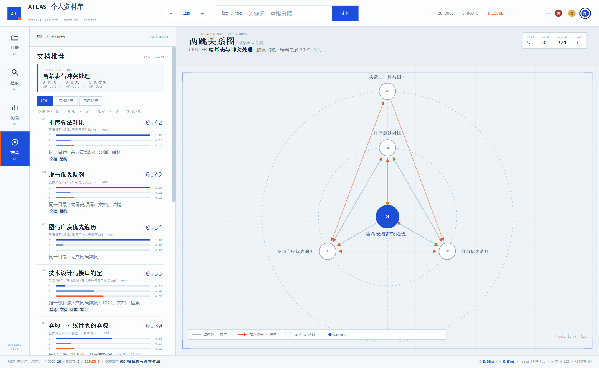

# Personal Library Search

[中文](README.md) | [English](README.en.md)

An offline document search and recommendation tool for Windows. It reads local Markdown files, UTF-8 plain text, and Word documents to help you find material by content and discover related documents.

## Screenshot



## Features

- Browse documents by directory.
- Search full text with multiple keywords and see matching documents, locations, and context; phrase search is also available.
- Count word frequencies for a document or directory (common words are filtered from analysis) and compare two sorting algorithms. Full-text search still indexes those words.
- Recommend documents based on directory relationships, word frequencies in their text, and shared high-frequency words; show each factor, association paths, document clusters, and a relationship graph.
- Process documents locally without uploading them.

## Current status

The repository includes document readers, tokenization, inverted-index search, word-frequency analysis, related-document recommendations, a shared service interface, automated tests, and a PySide6 desktop interface. Its sample library contains 34 original knowledge explainers organized into five subject areas.

## Desktop interface

Install dependencies and start the application:

```bash
python -m pip install -r requirements.txt
python main.py
```

On Windows, you can also double-click `运行.bat`.

The interface prefers the real `LibraryService`. If there is no `样例资料库/` directory in the project root or the real service fails to load, it falls back to 20 built-in demo documents. The window title and the top bar mark “演示数据” (demo data) so you can try the interface immediately. Add real documents to `样例资料库/` to use the real backend automatically.

The interface has three sections: directory, word frequency, and recommendations. The top search box supports word search and exact phrase search; submitting it opens a separate results view with snippets, hit positions, highlights, and document opening. The directory view shows a combined folder/document tree and animates a depth-first traversal on the right. The word-frequency view shows a hash-count grid, the Top-K min-heap, and block animations for quick/merge sort. The recommendation view shows the three score parts, weights, reasons, association paths, document clusters, and a two-hop graph anchored at the current start document. Documents open in a separate reading view with a collapsible directory and can be set as the recommendation start. In the top-right corner, you can switch between the “纸质档案”, “观察台”, and “制图台” visual themes. The `− / percentage / +` controls at the top zoom the entire page from 85% to 150% (125% by default). You can also use `Ctrl + mouse wheel`, `Ctrl+=`, `Ctrl+-`, or `Ctrl+0`.

The sample library is included in the repository in Markdown, plain-text, and Word formats.

## Install and test

Requires Python 3.13 or a compatible version.

```bash
python -m pip install -r requirements.txt
python -m unittest discover -s tests -v
```

Current tests cover core data structures, readers, service integration, and smoke tests using the GUI's demo data.

## Dependencies

PySide6, jieba, and python-docx. See `requirements.txt` for specific versions.

## License

Original source code and documentation in this repository are under the [MIT License](LICENSE).
