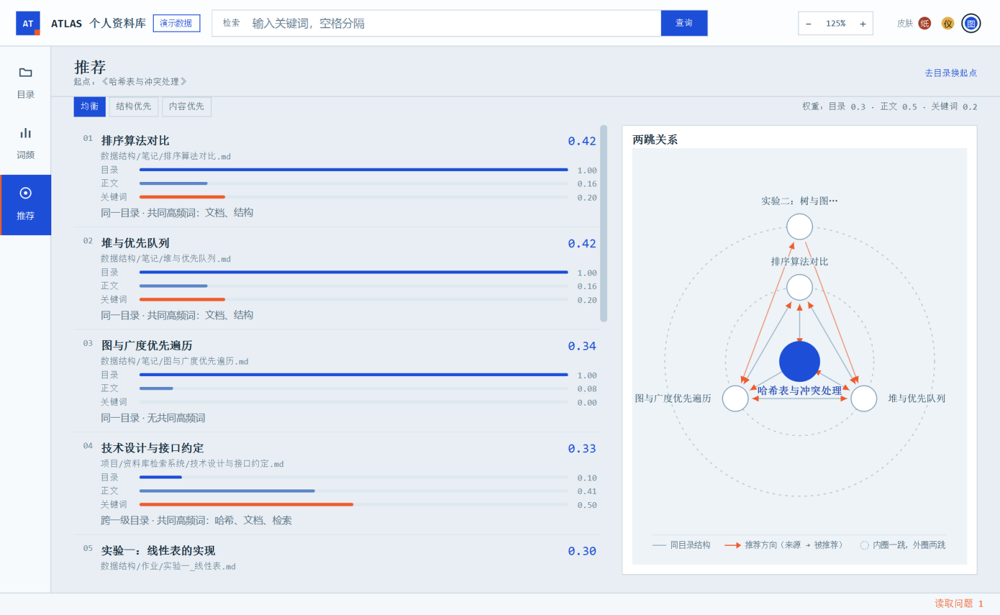

# 个人资料库检索系统

[中文](README.md) | [English](README.en.md)

Windows 离线资料检索与关联推荐工具。读取本地 Markdown、UTF-8 纯文本和 Word 文档，帮助用户按内容找回资料并查看相关文档。

## 界面预览



## 能力

- 按目录浏览文档。
- 多关键词全文检索，返回命中文档、位置和上下文。
- 对单篇文档或目录统计词频，并比较两种排序算法的结果。
- 根据目录关系、正文词频和共同高频词推荐文档，显示分项依据和关系图。
- 文档只在本机处理，不上传。

## 当前进度

仓库目前包含文档读取、分词、倒排检索、词频分析、关联推荐、公共服务接口、自动化测试，以及 PySide6 桌面界面。正式样例资料库尚未加入仓库。

## 桌面界面

安装依赖后启动：

```bash
python -m pip install -r requirements.txt
python main.py
```

Windows 也可以直接双击 `运行.bat`。

界面优先调用真实的 `LibraryService`。如果项目根目录没有 `样例资料库/`，或真实服务加载失败，程序会退回内置的 20 篇演示数据，窗口标题和顶部会标出“演示数据”；把真实文档放进 `样例资料库/` 后会自动改用真实后端。

界面分为目录、词频、推荐三个入口；顶部搜索框提交后进入独立的检索结果页，可查看命中片段、命中位置并打开文档。目录页左侧是文件夹树，右侧是当前目录的文档列表；词频页显示哈希计数、Top-K 最小堆和快速/归并排序的对照；推荐页显示三路分值、权重、推荐理由和当前起点的两跳关系图。文档在独立阅读页打开，可以直接设为推荐起点。右上角可以在纸质档案 / 观察台 / 制图台三套皮肤间切换；顶部 `− / 百分比 / +` 控制整页缩放（85%–150%，默认 125%），也支持 `Ctrl + 滚轮`、`Ctrl+=`、`Ctrl+-`、`Ctrl+0`。

样例资料库仍按 `.gitignore` 规则不进入仓库。

## 安装与测试

需要 Python 3.13 或兼容版本。

```bash
python -m pip install -r requirements.txt
python -m unittest discover -s tests -v
```

当前测试包含核心数据结构、读取器、服务集成，以及 GUI 在演示数据和真实后端下的集成测试。

## 依赖

PySide6、jieba、python-docx。具体版本见 `requirements.txt`。

## 许可

本仓库原创源码和文档采用 [MIT 许可证](LICENSE)。
